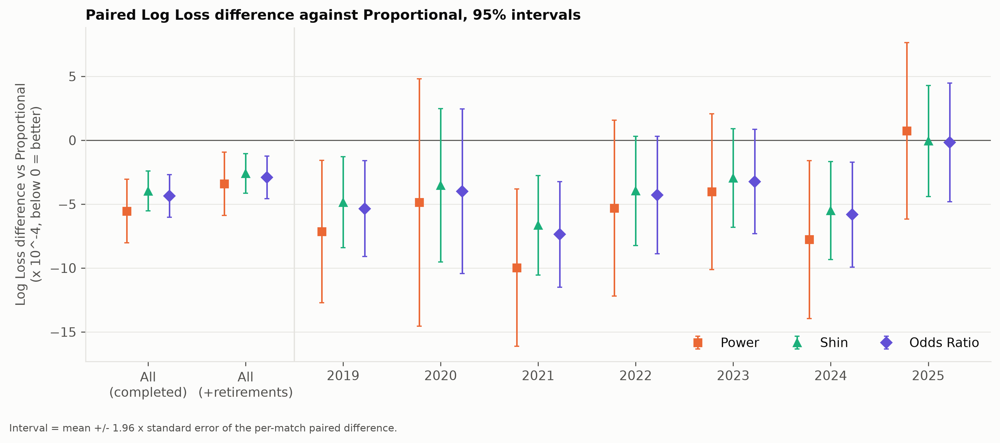
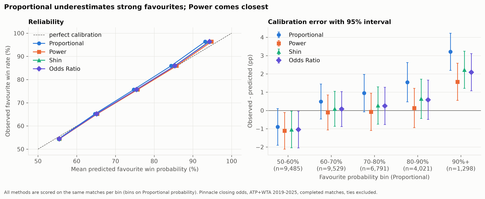
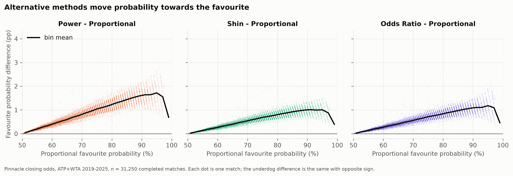
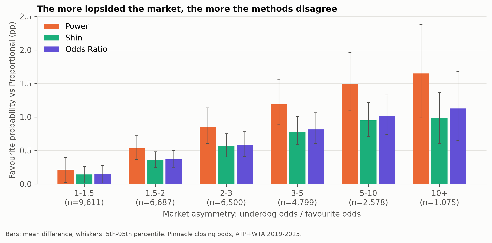
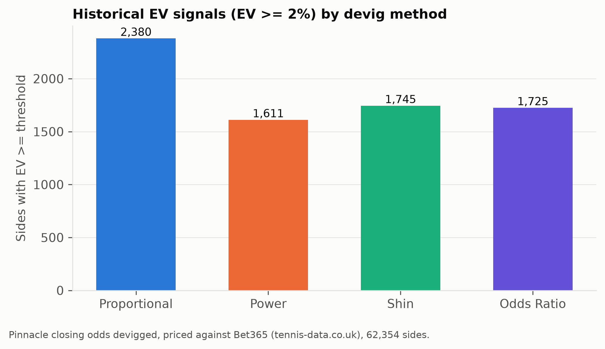
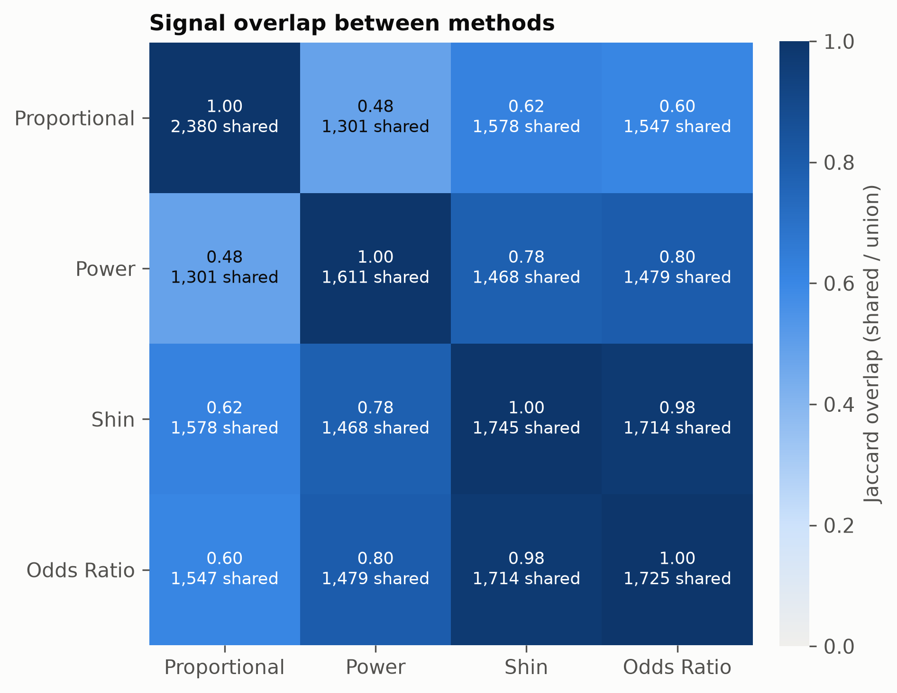
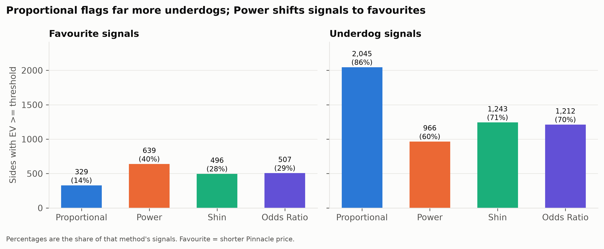

## Margin removal / devigging

The live pipeline's reference method is **Power** (see [Recommendation](#recommendation)), applied to two-way tennis match-winner markets. **Proportional normalization** is the simplest method and the baseline that the historical evaluation compares every other method against.

For decimal odds $o_i$, the raw implied probability is:

$$
q_i = \frac{1}{o_i}
$$

The normalized probability is:

$$
p_i = \frac{q_i}{\sum_j q_j}
$$

For the two-way tennis market:

$$
p_A = \frac{1/o_A}{1/o_A + 1/o_B}
$$

$$
p_B = \frac{1/o_B}{1/o_A + 1/o_B}
$$

### Alternative methods (implemented)

Three alternative methods are implemented in `src/betting/margin.py`. They differ in how the overround is distributed across the outcomes. In each case the parameter is found numerically (Brent's method) so that $\sum_i p_i = 1$.

**Power** (parameter $k \ge 1$):

$$
p_i = q_i^{k}
$$

**Odds ratio** (parameter $c \ge 1$):

$$
p_i = \frac{q_i}{q_i + c\,(1 - q_i)}
$$

**Shin** (parameter $z \in (0,1)$, the estimated share of insider money, with $\pi = \sum_j q_j$):

$$
p_i = \frac{\sqrt{z^2 + 4(1-z)\,q_i^2/\pi} - z}{2(1-z)}
$$

If the market has no overround ($\sum_i q_i \le 1$), all methods fall back to proportional normalization.

### Use in the live pipeline

`scripts/process_live_odds.py` computes the Pinnacle -> Betclic EV with all four methods (via `betting.value.ev_by_method`). Following the evaluation below, **Power** drives the main `probability`/`ev`/`best_ev` columns, the ranking and the signal statistics; Odds Ratio, Shin and Proportional are reported alongside it, in that order. Sessions recorded while Proportional was the reference are recalculated from their stored odds when they are displayed or exported (`results_store.complete_methods`). The cumulative `data/results/processed_odds.csv` is upgraded the same way: if it lacks any current column, the worker rewrites it once at startup with every row recalculated from its odds (the original is kept as a `processed_odds.*backup*.csv` copy). The logarithmic method and MPTO, mentioned in `docs/notes/devigging.md`, are not implemented yet.

## Empirical evaluation of the devig methods

Research question: *does the choice of devig method matter, and which method gives the most accurate probabilities from Pinnacle closing odds?*

All numbers below come from `scripts/evaluate_devig.py` (see [Reproducing the analysis](#reproducing-the-analysis)). Nothing was tuned, and the devig code in `src/betting/margin.py` was used unchanged.

### Data

* Source: tennis-data.co.uk Excel files, ATP and WTA main tour, 2019–2025 (`data/historical/raw/{atp,wta}/`), 32,877 rows.
* Odds: `PSW` / `PSL`, the Pinnacle closing odds for the winner and the loser.
* Loading and the base cleaning are reused from `scripts/load_historical.py` (`load_all`, `clean_matches`, `add_probabilities`, `to_sides`).

### Data preparation and assumptions

| Step | Rows left |
| --- | ---: |
| Loaded | 32,877 |
| `Comment == "Completed"`, valid `PSW`/`PSL` (> 1), date/players/tournament present, de-duplicated | 31,271 |
| Pinnacle overround in (1, 1.10] | **31,250** |

Decisions:

* **Walkovers** (243), **Awarded** (5), **Disqualified**, **Cancelled** and **Sched** (1 each) are removed: no tennis was played, or the result does not reflect the contest the odds priced.
* **Retirements** (972, including one row spelt `Rrtired`) are **excluded from the main analysis**. A retirement is decided by injury or illness, not by the contest the pre-match odds priced, and bookmakers settle them differently (Pinnacle voids a bet if a set is not completed, others settle at the retirement). The main analysis therefore follows the existing loader and keeps completed matches only. As a **sensitivity check**, the whole evaluation is repeated with retirements included, counting the player who advanced as the winner (32,200 matches).
* **Invalid odds**: missing odds and odds ≤ 1.0 are removed. In addition, 20 matches with a Pinnacle *underround* (overround ≤ 1, as low as 0.38 — clear data errors, and the alternative methods are undefined there) and 1 with an overround above 10% are removed. Pinnacle's median closing overround in the sample is 2.68% (ATP 2.56%, WTA 2.83%); the 99.9th percentile of the raw data is 6.8%.
* All methods are monotone in the raw implied probability, so they agree on which player is the favourite. 126 matches with identical odds have no favourite and are left out of the calibration analysis only.

### Evaluation methodology

For every match each method produces a winner probability $p$ from the two Pinnacle odds.

* **Log Loss**: $-\ln p_{\text{winner}}$, averaged over matches (lower is better). In a two-way market this equals the binary log loss of either side.
* **Brier Score**: $(1 - p_{\text{winner}})^2$, averaged (lower is better).
* **Paired differences**: for each match $d_i = \text{LL}_{\text{method},i} - \text{LL}_{\text{proportional},i}$. All methods are scored on the same matches, so the paired difference removes the large match-to-match variation in difficulty. Reported: the mean $\bar d$, the standard error $\text{SE} = s_d/\sqrt{n}$, $t = \bar d / \text{SE}$ and the 95% interval $\bar d \pm 1.96\,\text{SE}$. A cluster-robust SE (clusters = tour × year × tournament, 768 clusters) is also computed to allow for correlation within a tournament; it is practically identical to the plain SE.
* **Decision rule** (fixed before looking at the results): if a method's difference against Proportional is within about two standard errors ($|t| < 2$), prefer Proportional because it is simpler.
* **Calibration**: favourite win rate vs mean predicted favourite probability in the bins 50–60%, 60–70%, 70–80%, 80–90%, 90%+. The bins are defined on the Proportional probability, so every method is scored on exactly the same matches in each bin. Binning on each method's own probability gives the same conclusions (both versions are in `calibration.csv`). The interval on observed − predicted is $\pm 1.96\sqrt{\hat o(1-\hat o)/n}$.
* **EV signals** (illustrative, see the limitations): the project's own betting data is not yet large enough to analyse, so that part is skipped. To show how the method choice changes EV signals, the historical Pinnacle fair probability for each side is compared with the **Bet365** price in the same files (`B365W`/`B365L`), using the live pipeline's default threshold: EV = $p \cdot o_{\text{Bet365}} - 1 \ge 2\%$. Matches with an implausible Bet365 market (overround ≤ 1 or > 15%) are dropped, leaving 62,354 sides (31,177 matches).

### Results

#### Scores (main analysis, 31,250 completed matches)

| Method | Log Loss | Brier |
| --- | ---: | ---: |
| Proportional | 0.586203 | 0.201555 |
| Power | **0.585649** | **0.201465** |
| Shin | 0.585806 | 0.201481 |
| Odds Ratio | 0.585768 | 0.201477 |

#### Paired Log Loss difference against Proportional

| Method | Mean diff | SE | 95% interval | t | t (clustered) |
| --- | ---: | ---: | --- | ---: | ---: |
| Power | −0.000554 | 0.000127 | [−0.000803, −0.000305] | −4.36 | −4.30 |
| Shin | −0.000397 | 0.000080 | [−0.000553, −0.000240] | −4.97 | −4.91 |
| Odds Ratio | −0.000435 | 0.000085 | [−0.000602, −0.000268] | −5.12 | −5.03 |

All three alternatives beat Proportional by more than four standard errors. The paired Brier differences point the same way (t = −2.41 Power, −3.03 Shin, −3.04 Odds Ratio).

Between the alternatives (paired Log Loss, main analysis): Power beats Odds Ratio by 0.000119 (SE 0.000042, t = −2.83) and Shin by 0.000157 (SE 0.000048, t = −3.30). Odds Ratio beats Shin by 0.000038 (SE 0.000006, t = −6.30).

**Sensitivity check with retirements included (32,200 matches):** all alternatives still beat Proportional (t = −2.70 Power, −3.27 Shin, −3.43 Odds Ratio). Power is still the best point estimate, but its lead over Odds Ratio (t = −1.21) and Shin (t = −1.72) is **no longer significant**.

**Subgroups** (`paired_log_loss_by_*.csv`):

* Tour: the alternatives are better on both the ATP (t ≈ −2.2 to −2.8) and the WTA (t ≈ −4.0 to −4.5).
* Year: the point estimates favour the alternatives in every year from 2019 to 2024, individually significant in 2019, 2021 and 2024. **In 2025 there is no difference** (t = +0.21 Power, −0.03 Shin, −0.07 Odds Ratio).
* Favourite probability: the gain comes entirely from lopsided matches (90%+: t ≈ −6 to −7; 80–90%: t ≈ −1.8 to −2.3). In close matches (50–60%) the alternatives are slightly *worse* (t ≈ +1.7, not significant).



#### Calibration (favourite win rate, bins on Proportional probability)

| Bin | n | Observed | Proportional | Power | Shin | Odds Ratio |
| --- | ---: | ---: | ---: | ---: | ---: | ---: |
| 50–60% | 9,485 | 54.44% | 55.34% | 55.56% | 55.49% | 55.49% |
| 60–70% | 9,529 | 65.21% | 64.72% | 65.32% | 65.12% | 65.14% |
| 70–80% | 6,791 | 75.69% | 74.74% | 75.76% | 75.41% | 75.44% |
| 80–90% | 4,021 | 85.92% | 84.38% | 85.79% | 85.29% | 85.34% |
| 90%+ | 1,298 | 96.38% | 93.17% | 94.81% | 94.16% | 94.29% |

Proportional systematically **underestimates favourites** (and so overestimates underdogs), and the error grows as the market becomes more lopsided: 1.5 pp at 80–90% (z = 2.8) and 3.2 pp at 90%+ (z = 6.2). This is the favourite–longshot bias that the alternative methods are designed to absorb. Power is within one SE of the observed rate from 60% to 90%. At 90%+ every method still underestimates the favourite (Power by 1.6 pp, z = 3.0; Shin by 2.2 pp; Odds Ratio by 2.1 pp). In the 50–60% bin all methods slightly overestimate the favourite (z ≈ −1.8 to −2.2).



#### How much do the probabilities differ?

The alternatives always move probability from the underdog to the favourite, and the shift grows with market asymmetry. With Pinnacle's ~2.7% margin the differences are small in absolute terms. For close matches (underdog odds < 1.5 × favourite odds) the mean favourite shift is 0.21 pp (Power), 0.14 pp (Shin) and 0.15 pp (Odds Ratio). For lopsided matches (underdog odds ≥ 10 × favourite odds) it is 1.65 pp, 0.98 pp and 1.13 pp, with a maximum of about 4 pp. Shin and Odds Ratio are almost identical; Power makes the largest adjustment.





#### Effect on EV signals (historical Pinnacle -> Bet365, EV ≥ 2%)

| Method | Signals | Favourite | Underdog | Realised ROI (flat stake) |
| --- | ---: | ---: | ---: | ---: |
| Proportional | 2,380 | 329 (14%) | 2,045 (86%) | −5.2% ± 3.1% |
| Power | 1,611 | 639 (40%) | 966 (60%) | +3.3% ± 3.1% |
| Shin | 1,745 | 496 (28%) | 1,243 (71%) | +1.5% ± 3.3% |
| Odds Ratio | 1,725 | 507 (29%) | 1,212 (70%) | +1.9% ± 3.2% |

(± is one standard error. 6 signals per method are in markets with identical odds.)

Small probability differences matter for signals because the EV threshold is close to the bookmaker margin. Proportional produces **48% more signals than Power**, almost all of them extra underdog signals. Proportional and Power share only 48% of their combined signals (Jaccard 0.48), while Shin and Odds Ratio agree almost completely (0.98).

The signals that only Proportional produces are the important ones. The 1,079 sides flagged by Proportional but not by Power returned **−15.7% ± 5.1%** (the 802 not flagged by Shin: −18.7% ± 5.8%; the 833 not flagged by Odds Ratio: −18.4% ± 5.8%). That is about three standard errors below zero, and worse than the −7.6% from backing every side in the dataset (Bet365's median overround here is 5.5%). The extra underdog "value" found by Proportional is therefore mostly the favourite–longshot bias, not real value. The ROI of each method's full signal set is within about two standard errors of zero, so this does not show that any method is profitable.







### Interpretation

1. **Proportional is measurably the least accurate of the four.** Its Log Loss is higher than every alternative's by more than four standard errors. The result holds on both tours, with clustered standard errors, for the Brier Score, and with retirements included. The rule "prefer Proportional unless the difference exceeds about two SE" therefore does **not** apply.
2. **The mechanism is the favourite–longshot bias.** Pinnacle's closing prices still make strong favourites slightly too long and underdogs too short. Proportional passes this straight through; the other methods remove part of it. Accordingly, all of the gain comes from lopsided matches.
3. **The effect is small for probabilities but large for betting signals.** The Log Loss gain is ~0.0005 nats per match (≈ 0.1%). But EV thresholds are only a few percent, so Proportional creates many extra underdog signals, and those extra signals lost heavily in the historical data.
4. **Power vs Shin vs Odds Ratio is not settled.** Power is best in the main analysis (by 2.8–3.3 SE) and is the best calibrated, but its lead over the other two is not significant once retirements are included. Shin and Odds Ratio are nearly indistinguishable in practice.

### Limitations

* **Closing odds only.** The evaluation uses Pinnacle *closing* odds. The live pipeline uses pre-match odds captured earlier, when margins may be wider. The differences between methods grow with the margin, so the method choice probably matters at least as much live.
* **Main tours only.** Only ATP/WTA main-tour matches are included. The live pipeline also covers Challenger and ITF events, where margins are higher and the bias may differ; the results have not been verified there.
* **Not stable in every year.** There is no difference in 2025 alone. This could be noise (≈ 4,700 matches per year gives wide intervals) or a sign that the bias in Pinnacle closing prices is getting smaller. It should be re-checked as new seasons are added.
* **The signal analysis uses Bet365, not Betclic.** The timing of the Bet365 prices in tennis-data.co.uk is not guaranteed to match the Pinnacle closing price, so the historical signals were not necessarily available at the same time. The signal results show how much the method choice changes which bets are flagged; they are not a backtest of the live Betclic strategy. The ROI standard errors are large.
* **Multiple comparisons.** Many subgroup tests were run; only the pre-specified overall comparisons should be read as confirmatory. The main result (|t| > 4) survives any reasonable correction.
* **Remaining miscalibration.** Even the best method still underestimates favourites above 90%. MPTO and the logarithmic method remain untested.

### Recommendation

**Use the Power method as the primary devig method** for Pinnacle tennis match-winner odds, with **Odds Ratio** as the secondary method.

* Proportional should not be the primary method: it is significantly less accurate (> 4 SE), and its extra signals are systematically losing underdog bets.
* Power has the lowest Log Loss and Brier Score and the best calibration in the main analysis, and it is no more complex to use than Shin or Odds Ratio (one parameter, solved numerically).
* Its advantage over Odds Ratio and Shin is not robust (it disappears when retirements are included). A conservative option is to require that a live signal holds under both Power and Odds Ratio; the historical overlap (Jaccard 0.80) suggests this costs few signals.

The live pipeline follows this recommendation: Power is its reference method, and Odds Ratio, Shin and Proportional are reported next to it, in that order.

### Reproducing the analysis

```bash
pip install -e ".[historical,dev]"
python scripts/evaluate_devig.py      # cleaning, metrics, calibration, signals (EV threshold: --min-ev, default 0.02)
python scripts/plot_devig.py          # charts
pytest tests/test_evaluation.py
```

Inputs: the 14 tennis-data.co.uk files in `data/historical/raw/atp/` and `data/historical/raw/wta/` (`atp_2019.xlsx` … `wta_2025.xlsx`).

The outputs are kept separate from the live results:

| Path | Contents |
| --- | --- |
| `data/results/devig_evaluation/summary.json` | headline numbers |
| `data/results/devig_evaluation/historical/` | `cleaning_log.csv`, `raw_comment_counts.csv`, `scores.csv`, `paired_log_loss.csv` (all pairs), `paired_brier.csv`, `calibration.csv`, `paired_log_loss_by_{tour,year,favourite_bin,asymmetry}.csv`, `probability_differences_by_asymmetry.csv`, `matches_evaluated.csv`, and the `with_retirements_*` sensitivity files |
| `data/results/devig_evaluation/signals/` | `signal_counts.csv`, `signal_overlap.csv` (including the ROI of non-shared signals), `signal_counts_by_threshold.csv`, `sides_evaluated.csv` |
| `data/results/devig_evaluation/figures/` | 300-dpi PNG charts (copied to `docs/figures/devig_evaluation/` for this document, because `data/` is not committed) |

The metric functions are in `src/betting/evaluation.py`. The only change to existing code is an optional `valid_comments` argument to `clean_matches` in `scripts/load_historical.py` (default unchanged), used for the retirement sensitivity check.